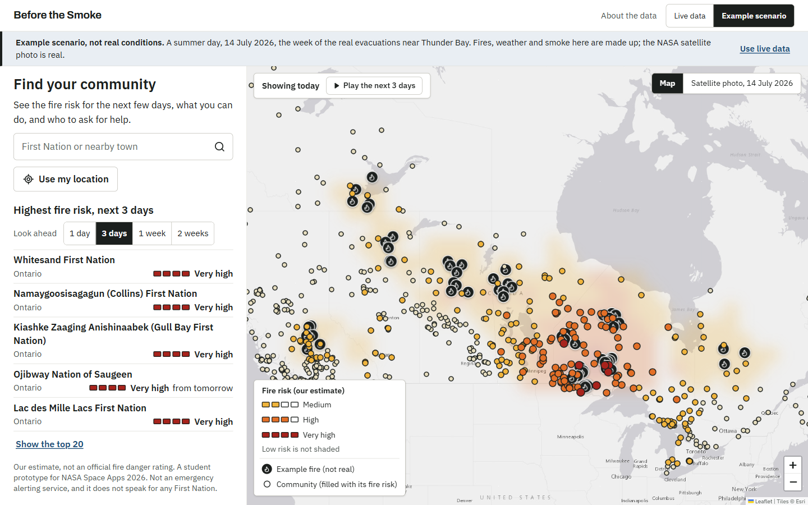
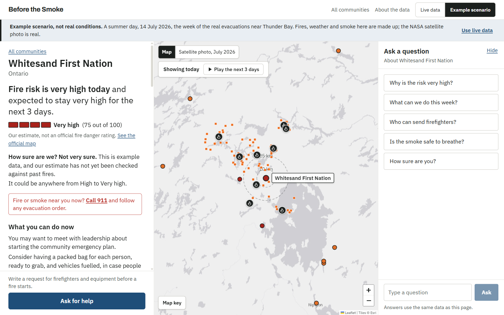
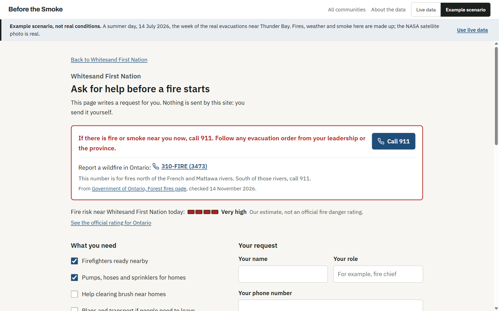
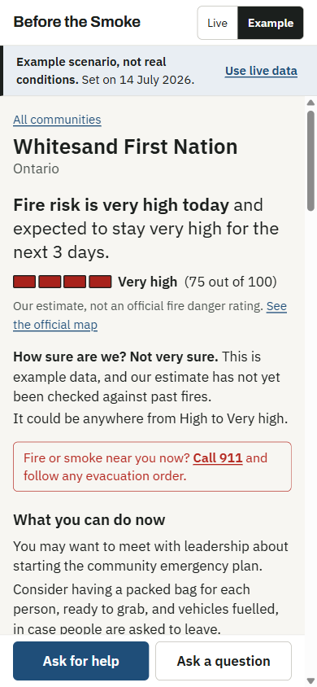
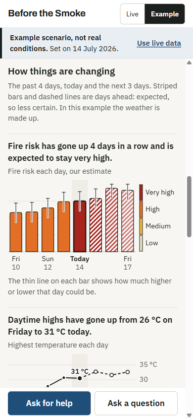
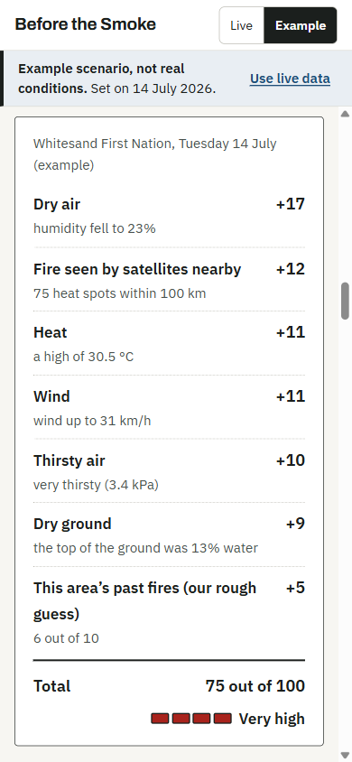

# Before the Smoke

**See it coming. Ask for help before anyone has to leave.**

Indigenous people are about 5% of Canada's population, but about 42% of wildfire evacuation events happen in majority-Indigenous communities. Before the Smoke is a prototype hub where a member of a First Nation can find their community, see the fire risk for the coming days in plain words, understand why, know what to do, and write a request for firefighters and equipment to the province and Indigenous Services Canada, before a fire starts.

It brings together NASA satellite fire detections and imagery, weather forecasts, 42 years of NASA daily weather records, Canada's official Fire Weather Index and wildfire reports, and Indigenous Services Canada's open list of First Nations locations.

Built in a weekend for the **NASA Space Apps Challenge 2026**.

> [!IMPORTANT]
> A student prototype. Not an emergency alerting service, not an official fire danger rating, and it does not speak for any First Nation. In an emergency, call 911.



<sub>All screenshots show the built-in example scenario (14 July 2026, the week of the real evacuations near Thunder Bay), which is labelled on every screen. The weather and fires in it are made up.</sub>

## What it does

| Screen | Address | What a visitor gets |
| --- | --- | --- |
| Find your community | `/` | Search every First Nation by name (accents and apostrophes optional), use your location, or pick from "Highest fire risk" for the chosen look-ahead. The map shows each community coloured by its fire risk, and reported wildfires. |
| Community | `/c/:id` | One sentence first ("Fire risk is very high today…"), a 4-step meter, how sure we are and why, what you can do now, the look-ahead (1 day to 2 weeks), the warning signs, charts of how things are changing, the nearest wildfire, the smoke, a comparison with 42 years of NASA records, and a 911 line when it matters. A built-in assistant answers questions from the same data. |
| Ask for help | `/c/:id/help` | 911 and the province's report-a-fire number first, then what you need, who to send it to (official contacts only, each with its source and the date it was checked) and a ready-to-send letter. Nothing is sent by the site. |
| Ask a question | `/c/:id/ask` | The assistant as a full page on phones. |
| About the data | `/about` | How the fire risk is worked out in everyday words, with a worked example added up like a shop receipt; what we take from each source and what it does; live status of every source; and details for experts. |

<table>
  <tr>
    <td colspan="3" width="50%"></td>
    <td colspan="3" width="50%"></td>
  </tr>
  <tr>
    <td colspan="3"><b>A community page.</b> The answer first, then why, what to do and who to ask.</td>
    <td colspan="3"><b>Ask for help.</b> Emergency numbers first, then a request letter to the right agencies.</td>
  </tr>
  <tr>
    <td colspan="2" width="33%"></td>
    <td colspan="2" width="33%"></td>
    <td colspan="2" width="33%"></td>
  </tr>
  <tr>
    <td colspan="2"><b>On a phone.</b> The same community page at 390 px.</td>
    <td colspan="2"><b>How things are changing.</b> Fire risk and the weather behind it, each chart with one plain sentence.</td>
    <td colspan="2"><b>About the data.</b> The score added up line by line, like a shop receipt.</td>
  </tr>
</table>

The look-ahead and the data mode are shared by every screen. There is one number per place: the community page, the map, the ranked list, the assistant and the letter all use the same score, worked out at the community's own location.

## How the fire risk is worked out

In everyday words: every day, for every community, we gather a few facts (how hot it is, how dry the air is, how windy, how much rain fell this week, how wet the ground is, whether satellites see fire nearby, and Canada's official fire weather reading), give each one some points, and add them up out of 100. Wind and a dry week only count in full when the air is warm and dry enough to dry things out, the way washing dries on a line. Under 25 is Low, 25 to 49 Medium, 50 to 74 High, and 75 or more Very high.

| Source | What we take | Most points it can add |
| --- | --- | --- |
| [Open-Meteo weather](https://open-meteo.com/en/docs) | Daily highest temperature, lowest humidity, strongest wind, rain, top-layer soil moisture, snow depth and vapour pressure deficit, from a week ago to two weeks ahead | 60 (humidity 13½, rain 12, wind 10½, heat 9, thirsty air 7½, dry ground 7½) |
| [Canada's fire weather stations](https://cwfis.cfs.nrcan.gc.ca/maps/fw?type=fwi) (CWFIS) | The official Fire Weather Index from the nearest station still reporting, within 200 km, today to two days ahead | 25 |
| [NASA FIRMS](https://firms.modaps.eosdis.nasa.gov/) | Heat spots seen by satellites in the last 24 hours, within 100 km (falls back to CWFIS's copy of the same data) | 9 |
| Our own rough guess | How often each area has burned in past years, set by hand | 6 |
| [CWFIS wildfire reports](https://cwfis.cfs.nrcan.gc.ca/) | Wildfires reported by fire crews: where, how big, under control or not, last update | shown beside the score |
| [Open-Meteo air quality](https://open-meteo.com/en/docs/air-quality-api) | Fine smoke (PM2.5) now and for the next few days | shown beside the score |
| [NASA POWER](https://power.larc.nasa.gov/) | Daily weather for each place since 1984 | shown beside the score |
| [NASA GIBS](https://nasa-gibs.github.io/gibs-api-docs/) | Satellite photos, including heat | shown beside the score |
| [Indigenous Services Canada](https://open.canada.ca/data/en/dataset/b6567c5c-8339-4055-99fa-63f92114d9e4) | Where each First Nation's main community is | puts communities on the map |

When there is no fire weather station nearby, the other facts share its points. Snow on the ground, or a day that stays at or below freezing, cuts the total to a fifth.

<details>
<summary><b>Details for experts</b></summary>

`shared/risk.ts`. Score = 100 × Σ(weight × sub-score), with nine inputs mapped linearly to 0–1: Canada's official Fire Weather Index at the nearest CWFIS station still reporting, within 200 km, for today and the next two days (25%, left out without lowering confidence when absent); minimum humidity (13.5%), 7-day rain (12%), wind (10.5%), maximum temperature (9%), satellite detections within 100 km (9%), vapour pressure deficit (7.5%), soil moisture (7.5%), and a hand-set regional history baseline (6%). Wind, rain and the baseline are multiplied by a drying power (0 at a vapour pressure deficit of 0.2 kPa, 1 at 1.0 kPa), so cold, damp, windy days are not scored as fire days. After the stations' last day (+2), the last reading is held. Snow cover or sub-zero maxima scale the result to 20%.

`server/risk-calibration.test.ts` checks the weather-only score (without the official index, so the check is not circular) against the official index on real data from 15 November 2026: 66 of 71 official-low places come out Low (23 before drying power). The weather alone misses the dry prairies (3 of 5 official-high places Low), which is why the index is also an input.

It is a relative estimate. The weights were chosen for readability and have not been fitted to or validated against fire records, so it is never shown as a probability, and the site says "our estimate, not an official fire danger rating" next to every level, with a link to the province's official rating.

The 42-year comparison uses NASA POWER daily data since 1984: today's percentile against the same weeks in past years, and Mann–Kendall trend tests with Sen's slope (`shared/stats.ts`). A trend is only described as a change when p < 0.05; otherwise the page says "not clearly".

</details>

## Two data modes

The switch is in the top bar.

- **Live data** calls the real providers. If one is unreachable, the page says so in words; live mode never substitutes invented numbers. Agency fire reports that no one has updated in 14 days, and where no satellite still sees heat, are left off (`server/fires.ts`). The CWFIS list keeps fires until an agency declares them out, and many never are: on 15 November 2026 it still held 105 fires, including Quebec fires from 2020 and 2023, of which 13 were current.
- **Example scenario** is a seeded, invented summer day, Tuesday 14 July 2026, the week of the real evacuations near Thunder Bay. A banner on every screen says so, example fires are labelled, and an example letter is marked "EXAMPLE ONLY" with an empty To line. The NASA satellite photo of 14 July 2026 is real.

## The assistant

The suggested questions ("Why is the risk very high?", "What can we do this week?", "Who can send firefighters?", "Is the smoke safe to breathe?", "How sure are you?") and common phrasings are answered by built-in rules from the community's own data and the verified contacts. They work offline and give the same answer every time.

Optional: with `ANTHROPIC_API_KEY` set, other free-form questions about an open community are answered by Claude (`claude-opus-5-5`, server-side refusal fallback enabled), given only that community's page data and the site's voice rules. Only the latest question is sent, calls are rate-limited (6 a minute per visitor, 300 an hour in total), and any failure falls back to the built-in answer. **This path has not been run against the live API**: the build machine had no credentials.

## Run it

Needs Node.js 22.9 or newer.

```bash
npm install
cp .env.example .env      # optional; the app runs with no keys
npm run dev               # API on :8787, site on http://localhost:5173
```

Production-style, on one port: `npm run build && npm start`, then open <http://localhost:8787>.

| Command | What it does |
| --- | --- |
| `npm test` | 117 unit tests: risk model, calibration against the official index, warning signs, statistics, look-ahead, letter, assistant, ranking, province lookup, stale fire reports, Fire Weather Index lookup, example scenario |
| `npm run typecheck` | TypeScript, no emit |
| `npm run build` | Typecheck and build the site into `dist/` |

### Optional keys

| Variable | What it adds |
| --- | --- |
| `FIRMS_MAP_KEY` | NASA FIRMS satellite fire detections (free, [request a MAP_KEY](https://firms.modaps.eosdis.nasa.gov/api/map_key/)). Without it, the app uses CWFIS's 24-hour hotspots. |
| `ANTHROPIC_API_KEY` | Free-form assistant answers (see above). |
| `DEFAULT_MODE` | `live` (default) or `sim` to open in the example scenario. |

Keys are read only in `server/` and never reach the browser; `.env` is git-ignored. Full report on every API: [docs/API_REQUIREMENTS.md](docs/API_REQUIREMENTS.md).

## Project layout

```text
shared/       Types and the logic the site and server share: risk model, Fire Weather Index lookup,
              warning signs, statistics, letter, assistant rules, contacts, province lookup
server/       Express API (TypeScript, run with tsx)
  sources/    One module per provider: cwfis, cwfisStations, firms, openMeteo, power, powerDaily
  fires.ts    Which agency fire reports count as current
  place.ts    One community's full report (/api/place/:id)
  ranked.ts   Every community scored the same way, for the ranked list and the map
  sim.ts      The example scenario, isolated in one file
  data/       Regions, hand-checked communities, ISC First Nations locations
  fixtures/   Real data from 15 November 2026 for the calibration test
src/          React 18 + Vite + Tailwind 4
  pages/      Home, Community, AskForHelp, AssistantPage, About
  components/ HeroMap, FindCommunity, Assistant, community/* (status, look-ahead, signs, trends,
              NASA record, fire and smoke), about/ScoreReceipt
scripts/      build-communities.ts (rebuilds the community list from the ISC open data),
              capture-weather-fixture.ts
docs/         Pitch script and guide, API report, plan and voice guide, research, design reviews
```

The first prototype, a map-first dashboard, is kept at the tag [`demo-stable-2026-11-14`](../../tree/demo-stable-2026-11-14).

## What has and has not been tested

| | Status |
| --- | --- |
| Home, community, ask for help, assistant, about: desktop 1440×900 and phone 390 px, example scenario | Clicked through in a browser |
| Community page charts ("How things are changing") | Checked in the example scenario at 1440 and 390 px; not at 768 px or in live mode |
| Unit tests | `npm test`: 117 pass |
| Weather-only risk score against Canada's official Fire Weather Index, real data from 15 November 2026 (80 communities) | `server/risk-calibration.test.ts` passes: 66 of 71 official-low places Low. One day, not a test against real fires |
| Live calls to Open-Meteo, CWFIS (fires, hotspots, fire weather stations), NASA POWER (daily and climatology) and NASA GIBS | Called successfully on 14–15 November 2026 |
| NASA FIRMS (VIIRS NOAA-20) | Called successfully on 15 November 2026: 150 detections over Canada in the last day. If FIRMS fails or rejects the key, today's heat falls back to CWFIS |
| The Claude assistant path (needs a key) | Not tested |
| Copy, Email and Print on the request letter | Not tested by clicking |
| Live-mode ranked list | Works; the first load for 641 communities takes several seconds, then it is cached for an hour |

## Known gaps

- The weights are hand-set and have not been validated against real fires.
- Canada's official Fire Weather Index is an input for today and the next two days only; that is all the station feed covers. No AQHI yet; the official provincial danger ratings are linked, not shown.
- Province for the ISC locations comes from simplified border lines (`shared/province.ts`, tested on border towns); a point within a few kilometres of a border can land on the wrong side.
- Some provinces publish no confirmed phone or email for the agencies we list; the site links the official page instead of guessing.
- Open-Meteo's free tier allows 10,000 calls a day, and one live refresh of all 641 communities costs roughly 1,000 to 1,300. The ranked list is cached for an hour, but restarting the server clears the cache, and repeated cold loads hit HTTP 429.

## Data ethics

Community locations come from Indigenous Services Canada's open data (Open Government Licence – Canada), using the published band-office point, plus a small hand-checked list. No cultural, land-use or personal data is used or collected, and nothing about visitors is stored on the server. The site was built without community involvement; a real deployment should be co-designed with, and governed by, the communities it describes, following the First Nations principles of OCAP® and Métis and Inuit data governance.

## Credits

Data: NASA FIRMS, NASA GIBS and NASA POWER; Natural Resources Canada's Canadian Wildland Fire Information System; Open-Meteo; Indigenous Services Canada (contains information licensed under the Open Government Licence – Canada). Background map © Esri. Preparedness guidance is sourced in [docs/research/preparedness.md](docs/research/preparedness.md) and agency contacts in [docs/research/contacts.md](docs/research/contacts.md).
